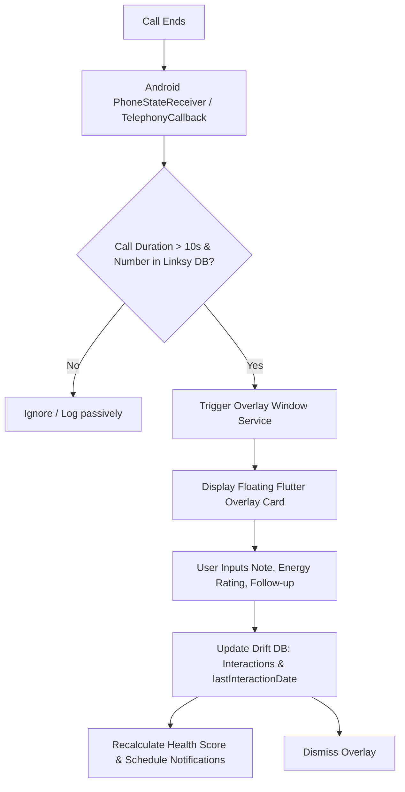

# 📞 Feature Proposal: Post-Call Interaction Note & Follow-up Popup

> **Status:** Proposed / Future Roadmap  
> **Target App:** Linksy (Personal & Professional Relationship CRM)  
> **Inspiration:** Truecaller-style post-call overlay, adapted for relationship health and interaction logging.

---

## 1. Executive Summary & Value Proposition

### The Problem
In Personal CRMs, **manual data entry friction is the #1 cause of user drop-off**. Users frequently have meaningful calls with friends, mentors, colleagues, or clients, but forget to open Linksy hours later to log notes, capture commitments, or rate the interaction. Context is lost (*"What was the book they recommended?"*, *"When did we agree to catch up again?"*).

### The Solution
Capture context at the **exact peak of recall** (0–5 seconds post-call) via an instant post-call dialog or high-priority actionable notification.
- Instantly rate the call's energy (`1` Draining to `5` Energizing).
- Jot down a 10-second interaction note (or voice note).
- Set an immediate follow-up reminder or adjust the relationship contact cadence.
- Automatically save the entry into Linksy's Drift SQLite database and recalculate the contact's **Relationship Health Score**.

---

## 2. Feature Debate & Feasibility Analysis

```
┌────────────────────────────────────────────────────────┐
│                      THE DILEMMA                       │
├───────────────────────────┬────────────────────────────┤
│    The Value (Utility)    │   The Risks (Friction)     │
│ • Captures zero-delay context │ • Can feel like intrusive spam│
│ • 1-tap Health Score updates  │ • Strict Android permissions  │
│ • Solves CRM manual fatigue   │ • Impossible overlay on iOS   │
└───────────────────────────┴────────────────────────────┘
```

### Advantages (Why do this?)
1. **Zero-Latency Data Capture**: Captures thoughts immediately without forcing the user to navigate the app.
2. **Habit Formation**: Connects a natural daily action (finishing a phone call) with the core Linksy loop (nurturing relationships).
3. **Synergy with Linksy Core**: Unlike Truecaller (which shows spam alerts and ads), Linksy’s card is focused entirely on **Relationship Health, Follow-up Scheduling, and Energy Rating**.

### Risks & Countermeasures
1. **Intrusiveness / "Truecaller Fatigue"**:
   - *Risk*: Users hate aggressive popups blocking their navigation or subsequent calls.
   - *Fix*:
     - **Smart Filtering**: Only trigger for numbers tracked in Linksy (or optionally show a subtle toast for untracked numbers).
     - **Call Duration Threshold**: Ignore calls under 10–15 seconds (missed calls, wrong numbers, automated IVRs).
     - **Auto-Dismiss Timer**: Progress indicator that closes the card after 8–10 seconds if untouched.
2. **OS Differences**:
   - **Android**: Fully supports overlay via `SYSTEM_ALERT_WINDOW` ("Draw over other apps") and `PhoneStateReceiver`.
   - **iOS**: Apple sandboxing strictly forbids overlays and phone call state interception.
   - *Fix*: Provide **High-Priority Actionable Notifications** as a cross-platform foundation and fallback.

---

## 3. Post-Call Card Design & Interaction Model

```
┌──────────────────────────────────────────────────────────┐
│  🟢 Alex Morgan  •  [Healthy - 85%]                      │
│  📞 Outgoing Call  •  4m 12s                             │
├──────────────────────────────────────────────────────────┤
│  How was the vibe?                                       │
│  [😫 1]  [😕 2]  [😐 3]  [😊 4]  [⚡ 5] (Energy Rating)   │
├──────────────────────────────────────────────────────────┤
│  📝 "Mentioned starting a new job next Monday..."        │
│  [ 🎙️ Tap to speak voice note ]                          │
├──────────────────────────────────────────────────────────┤
│  ⏰ Remind me to connect:                                │
│  [In 3 days]   [Next week]   [Reset Cadence (30d)]       │
├──────────────────────────────────────────────────────────┤
│  [ Dismiss (Auto in 8s) ]            [ Save to Linksy ✨]│
└──────────────────────────────────────────────────────────┘
```

### Core Features of the Card
1. **Contact Context**: Shows current health indicator (🟢 / 🟡 / 🔴) and call duration.
2. **1-Tap Energy Rating**: Maps directly to the existing `Interactions.energyRating` column (1 to 5).
3. **Quick Notes**: Quick text field with optional voice-to-text input.
4. **Follow-Up Presets**: One tap creates a scheduled notification or adjusts the person's `targetFrequencyDays`.
5. **Auto-Dismissal**: Progress bar that fades away if the user ignores it.

---

## 4. Technical Architecture & Implementation Plan

### A. Android System Overlay (Truecaller Style)



1. **Android Permissions Required**:
   - `android.permission.READ_PHONE_STATE`
   - `android.permission.READ_CALL_LOG`
   - `android.permission.SYSTEM_ALERT_WINDOW` (Draw over other apps)
2. **Flutter Integration Options**:
   - [`flutter_overlay_window`](https://pub.dev/packages/flutter_overlay_window): Native overlay rendering a secondary Flutter entry point (`@pragma("vm:entry-point")`).
   - Native Kotlin Background Service communicating with Drift SQLite or native SQLite.
3. **Opt-in Setting**:
   - Provide an onboarding card in Settings: *"Post-Call Assistant"* with a clear privacy explanation before asking for overlay permissions.

---

### B. Cross-Platform Actionable Notification (Fallback / Low-Friction Alternative)

For users who prefer not to grant overlay permissions (or on platforms without overlay support):

1. **Trigger**: When background call log sync (`CallLogSyncService`) or native phone state detects a completed call.
2. **Notification Payload**:
   - **Title**: `Finished call with Sarah?`
   - **Body**: `Tap to log notes, rate interaction, or set a reminder.`
   - **Actions**:
     - `[⚡ Log & Rate]` → Launches Linksy directly into `LogInteractionScreen` with contact pre-selected.
     - `[⏰ Remind Later]` → Schedules a 2-hour reminder to log context later.
     - `[Dismiss]` → Discards.
3. **Android Direct Reply**: Android notifications can support an inline text input field to type the note directly inside the notification drawer.

---

## 5. Phased Implementation Roadmap

| Phase | Milestone | Scope | Complexity |
| :--- | :--- | :--- | :--- |
| **Phase 1** | **Actionable Call Notification** | Extend `CallLogSyncService` to fire a local actionable notification with quick-action buttons when a call ends. | Low |
| **Phase 2** | **Android Overlay Assistant** | Implement `flutter_overlay_window` with `PhoneStateReceiver` for an instant Truecaller-like card. Add user toggle in Settings. | Medium-High |
| **Phase 3** | **Voice Memo & Smart Follow-Up** | Add voice-to-text transcription for notes and 1-tap reminders mapped to `flutter_local_notifications`. | Medium |

---

## 6. Database Integration Checklist

When the user saves from the popup:
- [ ] Insert record into `Interactions` table:
  - `personId`: Contact ID matching normalized phone number.
  - `date`: Call timestamp.
  - `type`: `'Call'`.
  - `notes`: User-provided note text.
  - `energyRating`: Selected rating (1–5).
- [ ] Update `People.lastInteractionDate` to call timestamp.
- [ ] Invoke `HealthScoreEngine.calculateHealth()` to refresh relationship status.
- [ ] Reschedule next overdue notification based on `targetFrequencyDays`.
